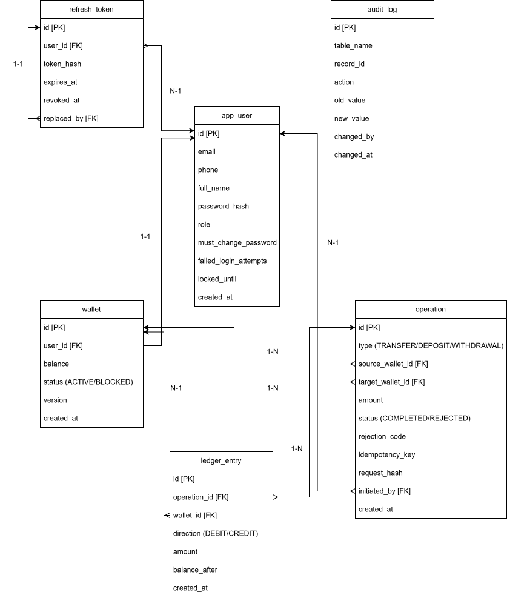

# Billetera digital

Billetera digital que permite el registro de clientes, la recarga y retiro de efectivo mediante cajeros, y las transferencias de dinero entre usuarios. Incluye un módulo administrativo para la gestión de cajeros y el bloqueo de billeteras.

## Cómo correrlo

### 1. Variables de entorno

El `.env` guarda los secretos del proyecto y **nunca se sube** al repositorio. `.env.example` es la plantilla y sí se sube.

Completá los valores en `.env`:

| Variable | Para qué | Ejemplo |
|---|---|---|
| `DB_NAME` | Nombre de la base de datos | `billetera_digital_bd` |
| `DB_USERNAME` | Usuario de PostgreSQL | `billetera_digital` |
| `DB_PASSWORD` | Password de PostgreSQL | *(secreto)* |
| `JWT_SECRET` | Clave de firma de los tokens JWT, codificada en Base64 | `Y2xhdmUtZGUtZWplbXBsby1wYXJhLWRvY3MtMzJieXQ=` |

> La clave JWT debe estar en **Base64** y tener al menos **32 bytes** (el mínimo que exige HS256). Generá una real con:
> ```bash
> openssl rand -base64 32
> ```

### 2. Levantar la base de datos

```bash
docker compose up -d
docker compose ps        # esperá a que STATUS muestre (healthy)
```

Para detener:

```bash
docker compose down       # conserva los datos
docker compose down -v    # borra el volumen y resetea la base
```

### 3. Correr los tests

Los tests de integración levantan su propio PostgreSQL con **Testcontainers**, así que no usan la base del `docker compose` ni necesitan el `.env`. Solo necesitan que Docker esté corriendo.

```bash
cd back-billetera-digital
mvn test
```

La suite corre las cuatro migraciones de Flyway contra un PostgreSQL 18.6 efímero y después verifica las reglas de la base:

| Qué se verifica | Tests |
|---|---|
| Las cuatro migraciones están aplicadas y son correctas | 1 |
| Disparador 1: `ledger_entry` no admite `UPDATE`, `DELETE` ni `TRUNCATE` | 3 |
| Disparador 2: un cambio de `wallet.status` se audita con su responsable; un `UPDATE` que no cambia el status, un `UPDATE` de otro campo o un `INSERT` no generan auditoría; sin responsable definido la operación falla | 5 |
| Restricciones: saldo no negativo, monto mayor a cero, correo único, llave de idempotencia única por usuario, `COMPLETED` sin código de rechazo se guarda y `REJECTED` sin código no | 6 |
| Restricción de billeteras según el tipo de operación: una recarga no lleva billetera de origen y una transferencia lleva las dos | 5 |

Cada test afirma **una sola** regla: además del tipo de excepción, comprueba el nombre de la restricción que saltó (`wallet_balance_check`, `operation_amount_check`, `app_user_email_key`, `operation_wallets_by_type_check`, `operation_rejection_code_by_status`, `operation_initiated_by_idempotency_key_unique`), que es lo que PostgreSQL devuelve en el mensaje. Si un `INSERT` dejara de ser válido por otra razón, el test cae.

## Modelo de datos



[Ver/editar en draw.io](docs/modelo-datos.drawio)

El esquema se crea **solo con migraciones de Flyway** (`src/main/resources/db/migration`). Está prohibido `spring.jpa.hibernate.ddl-auto=update`. Una migración ya aplicada no se edita: los cambios van en una versión nueva.

| Migración | Qué agrega |
|---|---|
| `V1__verificar_postgresql_18.sql` | Comprueba que la base es PostgreSQL 18 |
| `V2__tablas_y_restricciones.sql` | 5 tipos `ENUM`, 6 tablas, llaves foráneas y restricciones |
| `V3__disparador_ledger_entry.sql` | Disparador 1: `ledger_entry` solo admite inserciones |
| `V4__disparador_wallet_status.sql` | Disparador 2: cada cambio de `wallet.status` queda auditado |

## Decisiones tomadas

### Decisión: el UUID versión 7 lo genera la base de datos

- **Contexto:** todas las llaves primarias son UUID versión 7 y había que decidir quién lo genera.
- **Opciones:** la base, con `DEFAULT uuidv7()`; o la aplicación, con Hibernate.
- **Decisión:** la base, en las 6 tablas. Las llaves foráneas son `uuid` sin valor por defecto, porque no crean un identificador: guardan uno que ya existe en otra tabla.
- **Por qué:** hay filas que no crea Java. Las de `audit_log` las inserta un disparador, y la carga de 1.000.000 de asientos se hará con un script SQL. Si la base tiene que saber generar el identificador de todas formas, es mejor que sea la única fuente. Además, `uuidv7()` viene incluido en PostgreSQL 18. Un UUID versión 7 empieza con la marca de tiempo, así que los valores nuevos quedan al final del índice; uno versión 4 es aleatorio y cada inserción cae en cualquier parte del índice. Ese orden está garantizado dentro de una misma conexión; entre conexiones distintas es aproximado.
- **Costo:** Hibernate no conoce el identificador hasta después del `INSERT`. Cómo se mapea en las entidades se decide en el hito 2.

### Decisión: los estados y tipos son `ENUM` de PostgreSQL

- **Contexto:** cinco columnas solo aceptan un conjunto cerrado de valores: `app_user.role`, `wallet.status`, `operation.type`, `operation.status` y `ledger_entry.direction`.
- **Opciones:** `ENUM` de PostgreSQL; `VARCHAR` con un `CHECK`; o `VARCHAR` sin restricción, validando solo en Java.
- **Decisión:** `ENUM` de PostgreSQL en las cinco. `operation.rejection_code` es `VARCHAR(50)` de texto libre; su `CHECK` solo exige que tenga valor cuando el estado es `REJECTED` y que sea nulo cuando es `COMPLETED`.
- **Por qué:** la base rechaza un valor inválido aunque no venga de Java (un script, una corrección manual, un disparador). También lo rechaza dentro de las propias restricciones: un valor mal escrito en un `CHECK` falla al crear la tabla en lugar de quedar en silencio. `VARCHAR` sin restricción se descartó porque la base dejaría de defenderse.
- **Costo:** agregar un valor exige `ALTER TYPE`, y quitar o renombrar uno es difícil. Hibernate necesita configuración extra para mapearlos. Desde JDBC hay que convertir el texto al tipo (`?::operation_status`), y en el disparador de auditoría hay que convertir el estado a texto.

### Decisión: `audit_log` no tiene llaves foráneas

- **Contexto:** `audit_log` guarda qué registro cambió (`record_id`) y quién lo cambió (`changed_by`).
- **Opciones:** con llaves foráneas o sin ellas.
- **Decisión:** sin llaves foráneas.
- **Por qué:** `record_id` puede apuntar a una fila de cualquier tabla (la que diga `table_name`), y una llave foránea solo puede apuntar a una. Y la bitácora es un registro histórico: no debe depender de que el usuario siga existiendo.
- **Costo:** la base no garantiza que `changed_by` corresponda a un usuario real.

### Decisión: el cambio de estado falla si no hay responsable

- **Contexto:** el disparador de auditoría debe guardar el usuario de la aplicación que cambió `wallet.status`. PostgreSQL no lo conoce: todas las conexiones llegan con el mismo usuario de base de datos.
- **Opciones:** si nadie indicó el responsable, guardar la fila con el responsable en nulo; o rechazar el cambio.
- **Decisión:** rechazar el cambio. El disparador lanza un error y el cambio de estado se revierte.
- **Por qué:** una fila de auditoría sin responsable no sirve, y así un olvido se nota de inmediato. Funciona con una variable de sesión, `app.current_user_id`:
  - La aplicación la define con `set_config('app.current_user_id', <id>, true)`. El `true` hace que el valor viva solo hasta que termine la transacción. Es necesario porque las conexiones se reutilizan: sin él, la siguiente petición quedaría auditada a nombre del usuario anterior.
  - El disparador la lee con `current_setting('app.current_user_id', true)`. El `true` hace que devuelva nulo, en lugar de un error, si la variable nunca se definió en esa conexión.
  - `NULLIF(..., '')` cubre el otro caso: cuando la variable se definió en una transacción anterior de la misma conexión, queda como texto vacío, y así se convierte en nulo.
  - Si el resultado es nulo, el disparador lanza `No se puede auditar el cambio: falta definir app.current_user_id`.
  - El disparador solo corre cuando el estado cambia de verdad: `UPDATE OF status` descarta las sentencias que no tocan esa columna, y `WHEN (OLD.status IS DISTINCT FROM NEW.status)` descarta las que le ponen el mismo valor que ya tenía.
- **Costo:** todo el código que cambie `wallet.status` tiene que definir la variable antes, en la misma transacción. Si se olvida, falla al ejecutarse, no al compilar.
